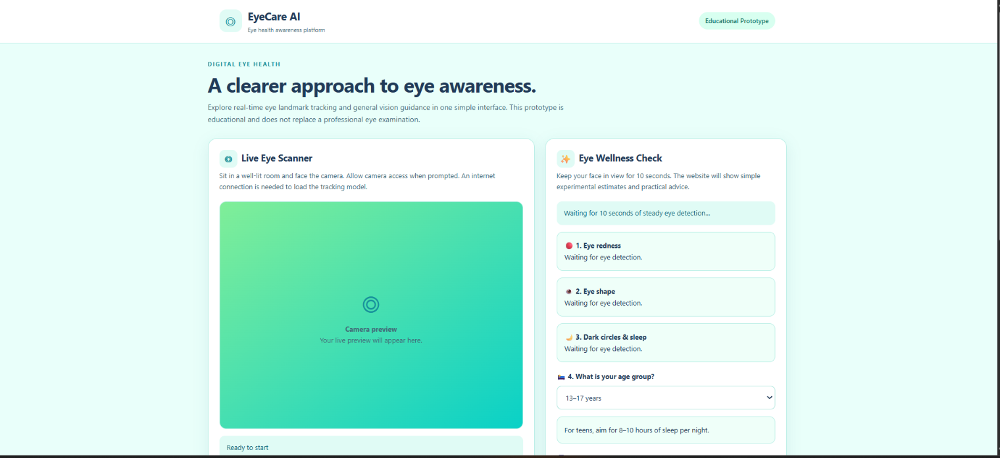

# 👁️ EyeCare AI

An experimental eye-wellness web project designed to explore basic camera-based eye analysis and provide general wellness guidance.

🔗 **Live Website:** https://suryaanarayyansenapati.github.io/EyeCareAI/

## ✨ Features

- 📷 Camera access for a live preview
- 👁️ Experimental eye-analysis results
- 🌙 General sleep guidance
- 💻 Screen-time wellness guidance
- 📱 Accessible through a web browser on desktop and mobile

## 🛠️ Technologies

- HTML
- CSS
- JavaScript

## 🚀 How to Use

1. Open the live website using the link above.
2. Allow camera access when prompted if you want to use the camera feature.
3. Follow the on-screen instructions to run the analysis.
4. Review the displayed results and general wellness guidance.

## ⚠️ Important Disclaimer

EyeCare AI is an experimental educational project. Its results are estimates and are **not a medical diagnosis**. Camera-based analysis may be affected by lighting, camera quality, and other factors. Do not use this project to diagnose or treat eye conditions. Consult a qualified healthcare professional about eye-health concerns.

## 🎯 Project Goal

The goal of this project is to explore browser-based web development, camera access, and interactive wellness features while continuing to learn and improve my development skills.

## 👨‍💻 Author

**Suryanarayan Senapati**

- GitHub: https://github.com/suryaanarayyansenapati
- Project: https://github.com/suryaanarayyansenapati/EyeCareAI

- ## 🖥️ Website Preview

🔗 **[Try EyeCare AI Live](https://suryaanarayyansenapati.github.io/EyeCareAI/)**
